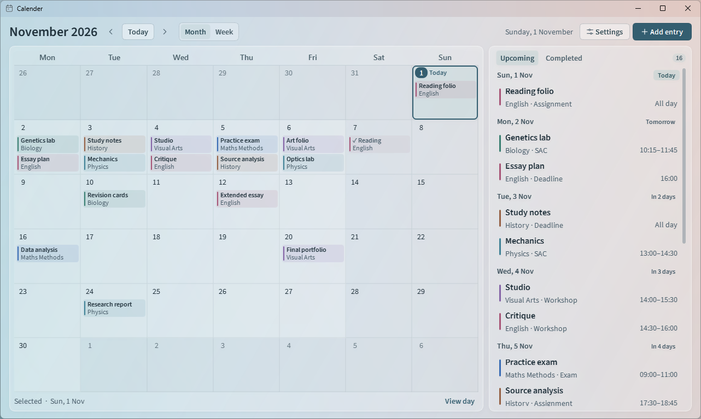
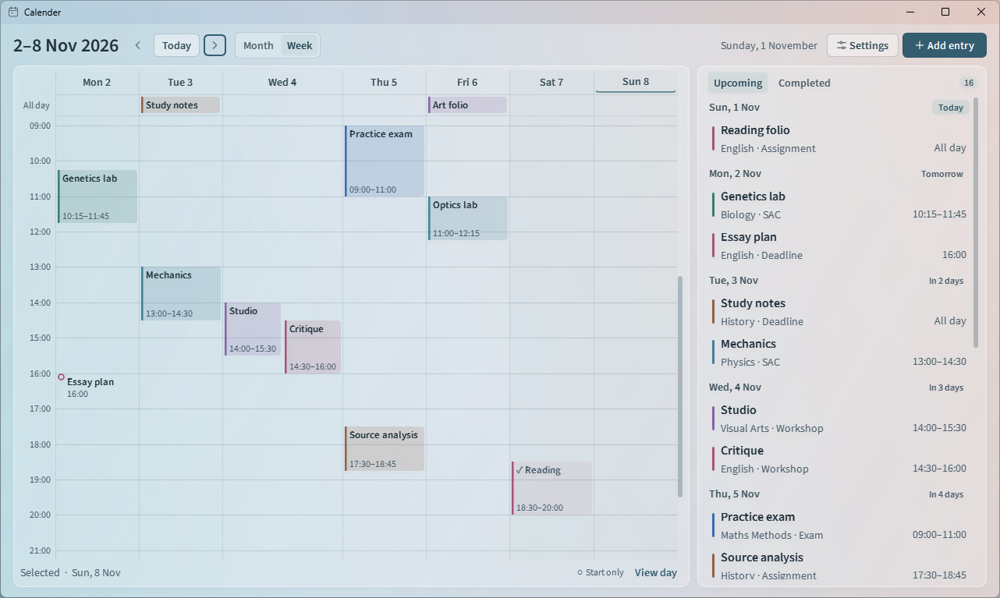
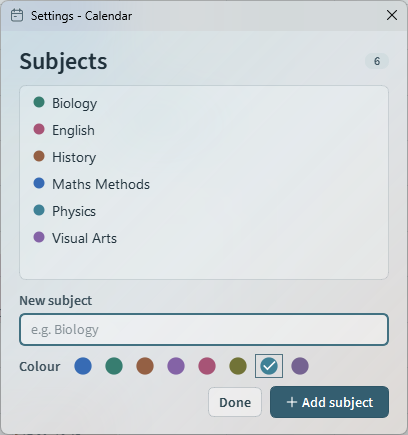

# Calender

A local Windows planner for SACs, exams, assignments, deadlines, and custom events. Calender opens to today in your last-used Month or Week view. It runs offline.

[Official Calender page](https://nottbradd.github.io/Calender/) · [Download the Windows installer](https://github.com/nottbradd/Calender/releases/download/v1.2.0/Calender-1.2.0-Setup.exe) · [Release notes and checksums](https://github.com/nottbradd/Calender/releases/tag/v1.2.0)

## Run on Windows

Run **Calender-1.2.0-Setup.exe** on an x64 PC with Windows 10 (1809 or later) or Windows 11. Setup installs for your account, adds **Calender** to Start and offers an optional desktop shortcut. Python and Qt are included. The installer is unsigned.

To update an installed copy, close Calender and run the new installer. To uninstall, open **Settings → Apps → Installed apps**, choose **Calender**, then **Uninstall**. Entries stay in the local database described below.

To run from source, use 64-bit Python 3.14 on Windows and open PowerShell in the project folder.

~~~powershell
py -3.14 -m venv .venv
.\.venv\Scripts\python.exe -m pip install -r requirements.txt
.\.venv\Scripts\python.exe -m school_calendar
~~~

The last command launches the app on subsequent runs.

## Plan your work

- Choose **Add entry** or click an empty date. A title and date are required. You can also add a subject, type, and notes. The **Custom** type accepts a name of your choice.
- Leave both times blank for an all-day entry. Set only **Start** for a single point in time, or set **Start** and **End** for a range. Use local 24-hour times. The end must be later on the same date.
- The filled badge in Month marks today. An outlined cell marks the selected day. Use the arrows to move one month or week, or **Today** to return to the current date. Switching views keeps the selected date.
- The **Upcoming** agenda includes unfinished past work first, then today and future dates. Within each day, all-day entries come first, followed by timed entries in clock order. Ties sort by title and then stable entry ID.
- Click an entry to read its details, edit it, or mark it complete. Use the **Completed** tab to find and reopen finished work. Deletion asks for confirmation and initially focuses **Keep entry**.
- Choose **+N more** on a busy date or **View day** below the calendar to see every entry. Subjects keep their colour across the grid, agenda, day list, and details.

### Week

The week starts on Monday. All-day entries stay above the schedule as you scroll. The timeline opens at 09:00, and you can scroll from midnight to the end of the day. Click a day heading or the all-day strip to add an untimed entry. Click a free time slot to start an entry at that quarter hour.

A coloured block spans the exact time range. A hollow circle marks a start with no end time. Overlapping entries sit side by side. Even a one-minute entry has a clickable title and time below its thin duration mark. On smaller windows **Show agenda** opens Upcoming and Completed alongside the week. Crowded days allow horizontal scrolling.

### Subjects

Open **Settings**, enter a subject name, choose a colour, and select **Add subject**. Saved subjects appear immediately in the **Subject** dropdown when you create or edit an entry. You can also type a subject directly into an entry to give it the next palette colour automatically.

| Keyboard action | Shortcut |
| --- | --- |
| Add an entry for the selected day | Ctrl+N |
| Return to today | Ctrl+T |
| Previous or next month or week | Alt+Left / Alt+Right |
| Open Settings | Ctrl+, |
| Move the selected date with the month grid focused | Arrow keys |
| Open the selected day / add on that date | Enter / Space |
| Move between controls | Tab / Shift+Tab |
| Save the editor | Ctrl+Enter or Ctrl+S |
| Dismiss a dialog | Escape |

## Local data

Calender opens the original database at **%LOCALAPPDATA%\SchoolCalendar\calendar.sqlite3**. The 1.3.1 prototype upgrades schemas 1–3 in a single transaction and keeps entry IDs, subject associations, views and existing sync profiles. New calendars start with sync disabled. The source and standalone versions share this location. Dates are stored as calendar dates and times as local clock times. Countdowns use the computer’s local date.

To back up a calendar, close every Calender window and copy the database file. To restore it on the same PC, close the app, keep a copy of your current database, and put the backup at the path above. A second synced PC should join with its own installation and database. If the app cannot read a file, it reports the error and preserves the file. A failed save leaves the editor open with your values.

## Sync prototype

The 1.3.1 development build offers encrypted sync under **Settings → Sync**. Disconnecting keeps unsent edits and deletions on this PC for their original calendar. Recovering that calendar resumes them, even after restarting the app. Assessments also keep their connection to a removed subject, so adding the subject again restores its label and colour on both PCs. The public 1.2.0 installer above is the earlier offline release. [Two-PC trial, screenshots and security design](backend/README.md)

## Appearance

Frosted glass is the default for the calendar, agenda, Settings and entry dialogs. On Windows 11 build 22621 or later, Desktop Acrylic lets colours from other windows or the wallpaper show through the active window with system blur. The panels and fields tint this material while text stays sharp. Windows can use a solid material when transparency is off or Battery Saver is active. Systems without the backdrop API use a painted gradient and translucent internal layers. [Windows backdrop support](https://learn.microsoft.com/en-us/windows/win32/api/dwmapi/ne-dwmapi-dwm_systembackdrop_type) · [Acrylic system behaviour](https://learn.microsoft.com/en-us/windows/apps/design/style/acrylic)

The interface uses the bundled upright variable font from the [Source Sans 3 release](https://github.com/adobe-fonts/source-sans/releases/tag/3.052R). The [font licence](school_calendar/assets/fonts/LICENSE.md) is included.

## Verify and build

The app uses Python, PySide6 Essentials (Qt Widgets), and Python’s built-in SQLite driver. With the virtual environment above, run the tests in a Windows desktop session. The interface tests briefly open real windows and use temporary calendars.

~~~powershell
.\.venv\Scripts\python.exe -m unittest discover -s tests -v
~~~

Build and launch the portable, single-file Windows executable with these commands.

~~~powershell
.\.venv\Scripts\python.exe -m pip install -r requirements-dev.txt
.\.venv\Scripts\python.exe .\scripts\build_windows.py
& ".\dist\Calender.exe"
~~~

To build the per-user installer, install [Inno Setup 6](https://jrsoftware.org/isdl.php). From the same development environment, point the build at your compiler. The release was built with Inno Setup 6.7.3.

~~~powershell
.\.venv\Scripts\python.exe .\scripts\build_installer.py --iscc "C:\Program Files (x86)\Inno Setup 6\ISCC.exe"
~~~

The installer build freezes a fresh directory runtime with replaceable Qt DLLs. This source version writes **Calender-1.3.1-Setup.exe** and **SHA256SUMS.txt** into **dist/release**. The [third-party notices](installer/THIRD-PARTY.md) are included in the installed app.

On a Windows test account without an existing Calender installation, run the installer smoke test in PowerShell 7. It creates a disposable calendar, tests both shortcut choices, reopens the saved entry after reinstalling, and checks the database after uninstalling.

~~~powershell
.\scripts\test_installer.ps1 -Installer .\dist\release\Calender-1.3.1-Setup.exe
~~~

The public site is served by GitHub Pages from **docs** on **main**. Its screenshots use sample entries. Build outputs, dependencies and personal calendars stay outside Git.

## License

Calender is released under the [MIT License](LICENSE). Bundled libraries and the Source Sans 3 font have their own licenses, listed in the [third-party notices](installer/THIRD-PARTY.md).
