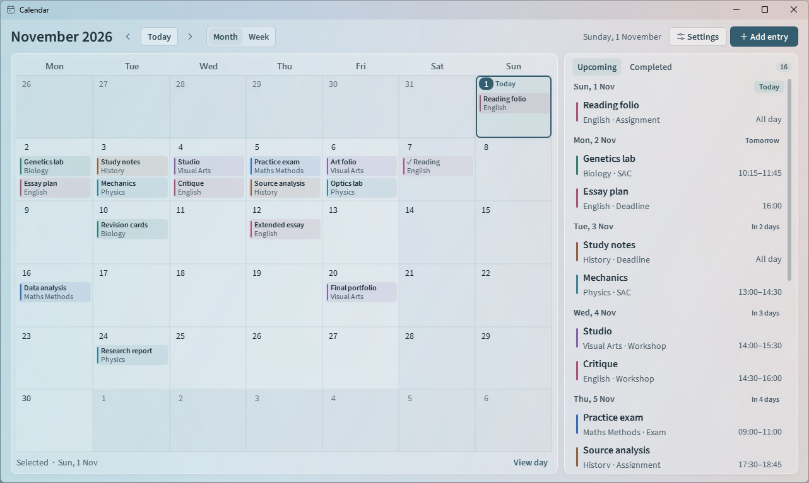
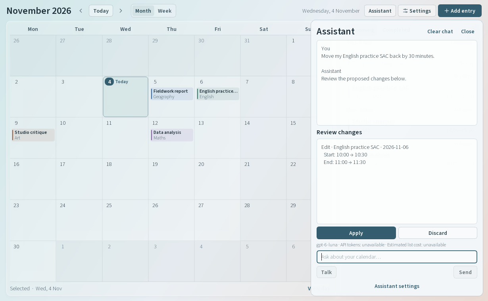

# Calendar

A local Windows planner for SACs, exams, assignments, deadlines, and custom events. Calendar opens to today in your last-used Month or Week view. It runs offline.

[Official Calendar page](https://nottbradd.github.io/Calendar/) · [Download the Windows installer](https://github.com/nottbradd/Calendar/releases/download/v1.2.1/Calendar-1.2.1-Setup.exe) · [Release notes and checksums](https://github.com/nottbradd/Calendar/releases/tag/v1.2.1)

## Run on Windows

Run **Calendar-1.2.1-Setup.exe** on an x64 PC with Windows 10 (1809 or later) or Windows 11. Setup installs for your account, adds **Calendar** to Start and offers an optional desktop shortcut. Python and Qt are included. The installer is unsigned.

To update an installed copy, close Calendar and run the new installer. To uninstall, open **Settings → Apps → Installed apps**, choose **Calendar**, then **Uninstall**. Entries stay in the local database described below.

To run from source, use 64-bit Python 3.14 on Windows and open PowerShell in the project folder.

~~~powershell
py -3.14 -m venv .venv
.\.venv\Scripts\python.exe -m pip install -r requirements.txt
.\.venv\Scripts\python.exe -m school_calendar
~~~

The last command launches the app on subsequent runs.

## Plan your work

- Choose **Add entry** or click an empty date. A title and date are required. You can also add a subject, type, and notes. The **Custom** type accepts a name of your choice.
- Leave both times blank for an all-day entry. Set only **Start** for a single point in time, or set **Start** and **End** for a range. Use local 24-hour times. The end must be later on the same date.
- The filled badge in Month marks today. An outlined cell marks the selected day. Use the arrows to move one month or week, or **Today** to return to the current date. Switching views keeps the selected date.
- The **Upcoming** agenda includes unfinished past work first, then today and future dates. Within each day, all-day entries come first, followed by timed entries in clock order. Ties sort by title and then stable entry ID.
- Click an entry to read its details, edit it, or mark it complete. Use the **Completed** tab to find and reopen finished work. Deletion asks for confirmation and initially focuses **Keep entry**.
- Choose **+N more** on a busy date or **View day** below the calendar to see every entry. Subjects keep their colour across the grid, agenda, day list, and details.

### Week

The week starts on Monday. All-day entries stay above the schedule as you scroll. The timeline opens at 09:00, and you can scroll from midnight to the end of the day. Click a day heading or the all-day strip to add an untimed entry. Click a free time slot to start an entry at that quarter hour.

A coloured block spans the exact time range. A hollow circle marks a start with no end time. Overlapping entries sit side by side. Even a one-minute entry has a clickable title and time below its thin duration mark. On smaller windows **Show agenda** opens Upcoming and Completed alongside the week. Crowded days allow horizontal scrolling.

### Subjects

Open **Settings**, enter a subject name, choose a colour, and select **Add subject**. Saved subjects appear immediately in the **Subject** dropdown when you create or edit an entry. You can also type a subject directly into an entry to give it the next palette colour automatically.

| Keyboard action | Shortcut |
| --- | --- |
| Add an entry for the selected day | Ctrl+N |
| Return to today | Ctrl+T |
| Previous or next month or week | Alt+Left / Alt+Right |
| Open Settings | Ctrl+, |
| Move the selected date with the month grid focused | Arrow keys |
| Open the selected day / add on that date | Enter / Space |
| Move between controls | Tab / Shift+Tab |
| Save the editor | Ctrl+Enter or Ctrl+S |
| Dismiss a dialog | Escape |

## Local data

Calendar opens the original database at **%LOCALAPPDATA%\SchoolCalendar\calendar.sqlite3**. The 1.3.1 prototype upgrades schemas 1–3 in a single transaction and keeps entry IDs, subject associations, views and existing sync profiles. New calendars start with sync disabled. The source and standalone versions share this location. Dates are stored as calendar dates and times as local clock times. Countdowns use the computer’s local date.

To back up a calendar, close every Calendar window and copy the database file. To restore it on the same PC, close the app, keep a copy of your current database, and put the backup at the path above. A second synced PC should join with its own installation and database. If the app cannot read a file, it reports the error and preserves the file. A failed save leaves the editor open with your values.

## Sync prototype

The 1.3.1 development build offers encrypted sync under **Settings → Sync**. Disconnecting keeps unsent edits and deletions on this PC for their original calendar. Recovering that calendar resumes them, even after restarting the app. Assessments also keep their connection to a removed subject, so adding the subject again restores its label and colour on both PCs. The public 1.2.1 offline installer above is the earlier offline release. [Two-PC trial, screenshots and security design](backend/README.md)

## Assistant prototype (1.5.0)

Run the prototype installer or portable executable on Windows x64, or launch `python -m school_calendar` from the Windows environment above. Choose a provider in **Settings → Assistant**. **Personal project key** uses your own project and preserves saved keys and model preferences when upgrading. **Hosted beta** uses an owner-funded invitation. It sends messages, selected calendar details and submitted audio through the Calendar AI service to OpenAI after you accept the notice. Each person's devices share one allowance. Offline planning and encrypted sync work independently. Use a fictional calendar while trying the prototype. [Hosted setup, limits and verification](backend/ai/README.md)

Open **Assistant** in the toolbar and type a request, such as “What assessments do I have next week?” Hold **Talk** and release to transcribe, or click **Talk** and choose **Stop**. **Cancel** discards the recording. The limit is 45 seconds. Edit the transcript, then choose **Send**. Voice capture uses Windows’ built-in waveform audio service.

Hosted participant access is currently **closed**. The [owner-only probe record](docs/hosted-owner-probe.md) describes the fictional test, its measured usage and the status of the provider spending controls.

Personal **Auto** routes routine requests to `gpt-6-luna` and constraint-heavy scheduling to `gpt-6.1-sol`. Personal settings also offer **Routine**, **Planning** and **GPT-5.4**. A turn can make up to four Responses requests, each capped at 1,800 output tokens in personal mode or 1,400 in hosted mode. Hosted model routing and spending ceilings are enforced by the service. The app displays available API usage and an estimated list-price cost. [Project sharing, retention, billing and fictional verification](docs/assistant-api.md)

The assistant can find assessments, calculate days remaining, check free periods and prepare changes to up to twelve entries at once. It checks timed overlaps locally. A start with no end reserves the rest of the day for planning, and untimed assessments are reported separately. Review the proposed values and click **Apply** to save. If the calendar changes underneath the proposal, send the request again for a fresh review.

[Compact drawer with a transcript ready to edit](docs/assistant-compact.png) · [Outstanding physical two-PC sync trial](backend/README.md#trial-on-two-windows-pcs)

## Appearance

Frosted glass is the default for the calendar, agenda, Settings and entry dialogs. On Windows 11 build 22621 or later, Desktop Acrylic lets colours from other windows or the wallpaper show through the active window with system blur. The panels and fields tint this material while text stays sharp. Windows can use a solid material when transparency is off or Battery Saver is active. Systems without the backdrop API use a painted gradient and translucent internal layers. [Windows backdrop support](https://learn.microsoft.com/en-us/windows/win32/api/dwmapi/ne-dwmapi-dwm_systembackdrop_type) · [Acrylic system behaviour](https://learn.microsoft.com/en-us/windows/apps/design/style/acrylic)

The interface uses the bundled upright variable font from the [Source Sans 3 release](https://github.com/adobe-fonts/source-sans/releases/tag/3.052R). The [font licence](school_calendar/assets/fonts/LICENSE.md) is included.

## Verify and build

The app uses Python, PySide6 Essentials (Qt Widgets), and Python’s built-in SQLite driver. With the virtual environment above, run the tests in a Windows desktop session. The interface tests briefly open real windows and use temporary calendars.

~~~powershell
.\.venv\Scripts\python.exe -m unittest discover -s tests -v
~~~

Build and launch the portable, single-file Windows executable with these commands.

~~~powershell
.\.venv\Scripts\python.exe -m pip install -r requirements-dev.txt
.\.venv\Scripts\python.exe .\scripts\build_windows.py
& ".\dist\Calendar.exe"
~~~

To build the per-user installer, install [Inno Setup 6](https://jrsoftware.org/isdl.php). From the same development environment, point the build at your compiler. The release was built with Inno Setup 6.7.3.

~~~powershell
.\.venv\Scripts\python.exe .\scripts\build_installer.py --iscc "C:\Program Files (x86)\Inno Setup 6\ISCC.exe"
~~~

The installer build freezes a fresh directory runtime with replaceable Qt DLLs. This source version writes **Calendar-1.5.0-Setup.exe** and **SHA256SUMS.txt** into **dist/release**. The installed app includes the [third-party notices](installer/THIRD-PARTY.md).

On a Windows test account without an existing Calendar installation, run the installer smoke test in PowerShell 7. It creates a disposable calendar, tests both shortcut choices, reopens the saved entry after reinstalling, and checks the database after uninstalling.

~~~powershell
.\scripts\test_installer.ps1 -Installer .\dist\release\Calendar-1.5.0-Setup.exe
~~~

The public site is served by GitHub Pages from **docs** on **main**. Its screenshots use sample entries. Build outputs, dependencies and personal calendars stay outside Git.

## License

Calendar is released under the [MIT License](LICENSE). Bundled libraries and the Source Sans 3 font have their own licenses, listed in the [third-party notices](installer/THIRD-PARTY.md).
