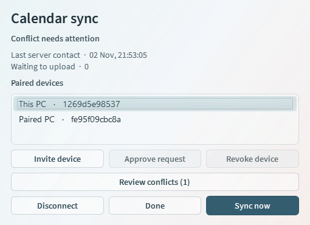
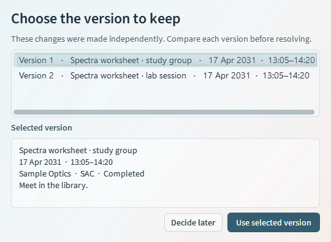

# Calendar encrypted sync prototype

The Windows desktop app is usable offline. Sync is opt-in under **Settings → Sync**. The development Worker `calendar-sync-dev` and the original `calender-sync-dev` Worker both use the `DB` binding on Workers Free. The binding points to the existing D1 database named `calender-sync-dev`. Both addresses share the same device directory and encrypted changes. [Live health check](https://calendar-sync-dev.nottbradd.workers.dev/health)

## Trial on two Windows PCs

1. Use the same Calendar prototype build on both PCs. You can build it from the repository with the [Windows build instructions](../README.md#verify-and-build). For a disposable trial, run the following in PowerShell on **each** PC. Use a new folder name for each trial, reuse that folder on restarts, and substitute the path to your prototype executable.

   ~~~powershell
   $env:LOCALAPPDATA = Join-Path $env:TEMP 'Calendar-Trial-01'
   & 'C:\path\to\Calendar.exe'
   ~~~

2. Before linking, add a sample assessment with a subject on A, remove the subject in Settings, and leave B empty. On A open **Settings → Sync → Create calendar**. Save the private recovery key offline and confirm that you saved it. Choose **Invite device**, select the invitation and copy it. Share it privately with PC B. It expires in ten minutes. Issuing another invitation replaces the previous one.
3. On PC B open **Settings → Sync → Join calendar** and paste the invitation. Read the 12-character verification code shown on B to the person at A over a trusted channel. On A select **Sync now → Approve request** and enter B’s code. Select **Sync now** on B. Both PCs should list two devices.
4. Verify the subject is hidden on both PCs. Add the same subject again on A, choose a colour, and select **Sync now** on A and then B. The assessment should display the same label and colour on both.
5. Take A offline, delete that assessment, then choose **Settings → Sync → Disconnect** while still offline. Close Calendar. Reopen the same profile, reconnect the network, choose **Recover** with the saved key, and sync A then B. The assessment must stay deleted on both PCs, with no conflict or waiting upload.
6. Add another sample assessment and sync both PCs. Take B offline, edit the same assessment independently on both, reconnect B and sync both. Use **Review conflicts** to compare both versions and choose one; sync the resolution.
7. On A select B in **Paired devices** and choose **Revoke device**. A rotates the key. B’s next check should report access denied. On a replacement PC choose **Recover** and enter the offline key. If every prior PC was lost, select the option to revoke all of them and rotate the key during recovery.

First-time linking imports the standalone entries and subjects already on the PC. Entries keep their original IDs. Different IDs survive as separate entries, identical versions of one ID coalesce, and divergent versions are offered for resolution. The initial upload includes removed subjects' saved names and colours, their removal records, and each assessment’s original association. Month/Week preferences stay local.

**Disconnect** forgets the local credentials and keeps the calendar editable. The PC retains pending edits, deletions, and their parent versions for the original calendar, including edits made while disconnected. Rejoining or recovering the same calendar resumes this history. Successfully linking a different calendar opens its own entries and queue; returning to the first restores its history. A failed link leaves the open calendar in place. Resolve conflicts before disconnecting. Use **Revoke device** on another paired PC to remove the old credential from the server.

Back up a closed database before upgrading. Version 1.3.1 upgrades the 1.3.0 database in place and repairs a previously blank sync association when the local entry still identifies its subject. A deletion already discarded by disconnecting under 1.3.0 cannot be reconstructed. On a second PC, start with its own database and join; copying a linked database can duplicate the device identity.

## Authentication, encryption and recovery

- Each installation creates a UUIDv4 device ID, 256-bit bearer and X25519 keypair. Every feed, upload and management request authenticates against the requested calendar over HTTPS. D1 stores bearer hashes. Calendar creation, invitation claims and recovery have indexed, one-minute attempt budgets per source and per calendar. The creation limit is 8 per minute per source, and the claim and recovery limits are 24. A pending device can request approval but cannot read or write changes. Active devices have equal authority to approve or revoke another device.
- Invitations contain a 256-bit random ticket and a commitment to the calendar’s first key. D1 stores the ticket hash, expiry and at most one claimant. Approval verifies a fingerprint of the claimant’s device ID and public key. Membership changes use conditional updates on the directory generation. Concurrent approvals, recovery and revocation must refresh the directory before retrying.
- The desktop serialises the entry or subject, including identifiers, fields, causal parents and deletion state, and encrypts it with PyNaCl’s XChaCha20-Poly1305 AEAD. A fresh 192-bit nonce is generated for each encryption. Associated data binds the ciphertext to the calendar, operation ID and key epoch. X25519 sealed boxes carry the keyring to approved devices. Clients check the original key commitment, continuity with previously held keys and keyed authentication tags on recipients before rotating or sharing keys. [PyNaCl AEAD](https://pynacl.readthedocs.io/en/latest/secret/) · [libsodium sealed boxes](https://doc.libsodium.org/public-key_cryptography/sealed_boxes)
- Device bearers, private keys and cached keyrings are sealed with current-user Windows DPAPI in the local SQLite profile. The desktop’s ordinary calendar and causal history are readable to that Windows user. Worker management credentials are used solely by Wrangler. The service sees random IDs, membership, public keys, epochs, ciphertext sizes and access timing. Application logs exclude request bodies and credentials, and persistent Worker observability is disabled. [Windows DPAPI](https://learn.microsoft.com/en-us/windows/win32/api/dpapi/nf-dpapi-cryptprotectdata)
- The offline recovery key contains the calendar ID and a random 256-bit seed. Separate HMAC-SHA-256 domain labels derive a recovery authenticator, an X25519 recovery private key and the first content key. D1 stores a hash of the authenticator, the recovery public key and an encrypted keyring. A replacement PC validates the key commitment, decrypts the keyring locally and registers its new credential. A pending recovery is DPAPI-protected and cleared on activation. An active profile does not keep the recovery seed. Anyone with the offline key can recover access. If all devices and the key are lost, the hosted ciphertext is unrecoverable.
- Revoking a member atomically removes its access, cancels pending invitations and increments the epoch. A fresh random key and historical keys are sealed for surviving devices and the recovery public key. A surviving offline PC fetches its new envelope before uploading. Old-epoch uploads are rejected. Rotation protects future changes. It cannot erase old downloads, retrieve previously disclosed keys, or invalidate an independently retained recovery copy.

## Reliability and limits

A local edit, its stable operation ID and its parent versions are recorded in one SQLite transaction. Applying a downloaded page and advancing its cursor also share a transaction. The server indexes the feed by calendar and sequence, deduplicates by calendar and operation ID and checks membership generation inside the data transaction. A lost response can be retried. Downloaded operations do not enter the upload queue.

The current versions of an object are the operations that no known child supersedes. Concurrent versions with different values remain available until a resolution references all current versions. A concurrent deletion wins the ordinary calendar display while keeping the competing edit in the conflict screen. Disconnect retains this history under the commitment to the calendar ID and its first encryption key. A fresh device credential can replay the feed on recovery: old operations are recognised by ID, and the original pending deletion can then upload with its original parents.

An idle PC makes one incremental request roughly every 90–100 seconds. Local edits are debounced, linking polls about every 12–15 seconds, and transient errors back off to about 15 minutes. **Sync now** makes an immediate check. The UI counts unacknowledged changes and records the last successful server contact. Uploads are acknowledged by stable operation ID. Transfers use pages of 24 changes and bounded request bodies. An individual change above roughly 512 KiB of serialised plaintext stays local until shortened. Other changes can still upload. The prototype supports 12 normal paired devices plus a recovery slot. History compaction, recovery-key replacement, and an independent security review remain future work.

## Run, deploy and verify

Use Node.js 22+ with npm in this directory. The desktop tests and trial harness use the repository's Windows Python environment.

~~~sh
npm ci
npm test
npx wrangler d1 migrations apply DB --local
npm run dev -- --port 18787
~~~

Run the local trial from the repository root in another PowerShell session. It creates disposable Windows profiles and exercises pairing, offline edits, retries, conflict resolution, revocation, rotation and recovery. The audit inspects stored values and removes only calendars generated by that trial.

~~~powershell
$env:CALENDAR_LOCAL_UI_TRIAL = '1'
.\.venv\Scripts\python.exe -m unittest discover -s tests -v
.\.venv\Scripts\python.exe scripts/verify_sync.py --audit
~~~

Wrangler uses browser OAuth and keeps its session in the developer’s user profile. Apply migrations once to the shared development database. The deploy script publishes the same source to both Worker names so already-installed clients can continue syncing at their original address.

~~~sh
npx wrangler login --scopes account:read user:read workers:write workers_scripts:write d1:write
npx wrangler whoami
npx wrangler d1 migrations apply DB --remote
npm run deploy
~~~

To replay the three regression cases against the deployed development Worker, set the following variables in a separate shell. The tests use fresh calendars, clean them up through Wrangler, and start a new Windows process for the restart-and-recovery case.

~~~powershell
$env:CALENDAR_LOCAL_UI_TRIAL = '1'
$env:CALENDAR_REGRESSION_BASE = 'https://calendar-sync-dev.nottbradd.workers.dev'
.\.venv\Scripts\python.exe -m unittest discover -s tests -p test_sync_regressions.py -v
~~~

For the full deployed trial, run the log check in one terminal and the following trial in another. The log check filters on the disposable trial header and inspects events in memory. The optional packaged check starts two executable instances with isolated local profiles. Omit `--peer-packaged` to use the same build twice.

~~~powershell
.\.venv\Scripts\python.exe scripts/check_sync_trace.py
# In a second terminal at the repository root
.\.venv\Scripts\python.exe scripts/verify_sync.py --base https://calendar-sync-dev.nottbradd.workers.dev --audit --packaged .\dist\Calendar.exe --peer-packaged .\dist\installer-runtime\Calendar\Calendar.exe
~~~

## 1.3.1 verification · 2 November 2026

All 33 desktop tests and six Worker tests passed, including the Qt pairing test against local Wrangler. The regression cases also passed against the deployed development Worker: recovery in a fresh Windows process uploaded the original deletion, a different calendar with the same entry ID received zero uploads, and both installations restored the same subject and colour. An additional upgrade check used a database created by commit `902b224`, with both an unsent deletion and a hidden subject.

The portable executable recovered a disconnected profile and sent its offline entry and deletion to the installer runtime. The installer passed install, launch, save, reinstall, shortcut, uninstall and database-preservation checks. Both builds were tested on **one Windows PC with isolated profiles**. The next milestone is the [trial on two physical PCs](#trial-on-two-windows-pcs).

The full deployed trial harness made 97 requests, sent 15,687 bytes of JSON and received 63,866 bytes of successful JSON responses, excluding headers, Wrangler calls and the two executable processes. The feed contained 20 distinct encrypted operations; an idle check took one request. The D1 audit and filtered live push/pull traces found no sample plaintext or exposed credentials. The disposable remote calendars and their changes were removed.

## Rename compatibility · 4 November 2026

The archived 1.3.1 client uploaded a fictional assessment through its original Worker address. A separate profile running the renamed client recovered the same calendar through the new address and edited the assessment. The 1.3.1 client then downloaded and decrypted that edit. Both live health endpoints passed their D1 check. The disposable calendar and feed were removed after the trial.
